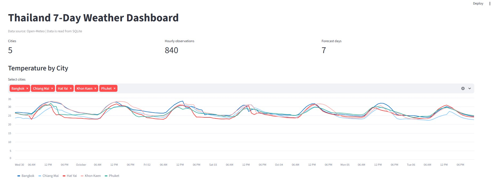
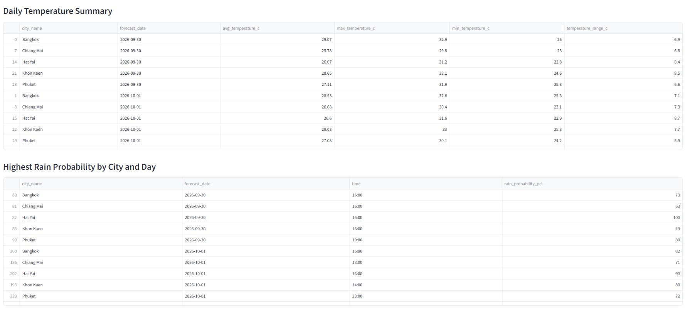

# Weather Data Pipeline

A small end-to-end Data Engineering pipeline built for the Ooca Data Engineer Internship assessment.

## Tech stack

- Python 3.10+
- Open-Meteo Forecast API
- SQLite
- Pandas
- Streamlit

Open-Meteo is used because it provides a free forecast API without an API key. The pipeline requests 7 days of hourly `temperature_2m` and `precipitation_probability` data in local Bangkok time. Open-Meteo documents that the default 7-day forecast contains hourly forecast data and supports named time zones.  
Source: https://open-meteo.com/en/docs

## Project structure

```text
weather-data-pipeline/
├── README.md
├── requirements.txt
├── ingestion.py
├── dashboard.py
├── schema.sql
├── weather.db                 # created after running ingestion.py
├── raw/                       # raw API JSON files, created by ingestion.py
├── results/                   # SQL result CSVs, created by export_results.py
├── sql/
│   ├── 01_daily_temperature.sql
│   ├── 02_widest_temperature_range.sql
│   ├── 03_highest_rain_probability.sql
│   └── 04_daily_temperature_change.sql
└── export_results.py
```

## 1. How to run

Create and activate a virtual environment:

```bash
python -m venv .venv
```

Windows:

```bash
.venv\Scripts\activate
```

macOS/Linux:

```bash
source .venv/bin/activate
```

Install dependencies:

```bash
pip install -r requirements.txt
```

Run the ingestion pipeline:

```bash
python ingestion.py
```

Export the SQL results:

```bash
python export_results.py
```

Start the dashboard:

```bash
streamlit run dashboard.py
```

The dashboard reads from `weather.db`; it does not call the API directly.

## 2. Schema design

I separated relatively stable city information from hourly weather observations.

### `cities`

Stores one row per city:

- `city_id` — integer primary key
- `city_name` — unique city name
- `latitude`
- `longitude`
- `timezone`

### `weather_hourly`

Stores one observation for a city at a specific local forecast time:

- `city_id`
- `forecast_time`
- `temperature_c`
- `rain_probability_pct`

The composite primary key `(city_id, forecast_time)` is the natural key for an hourly forecast observation. It prevents duplicate rows for the same city and forecast timestamp.

This design avoids repeating city coordinates and metadata in every hourly row while keeping the weather fact table simple for analytical queries.

## 3. Idempotency

The ingestion is idempotent.

For every city, rows are written using SQLite's:

```sql
INSERT ... ON CONFLICT(city_id, forecast_time) DO UPDATE
```

Therefore, running the pipeline repeatedly updates the same forecast observations instead of creating duplicates.

For example, if the first run loads 840 rows, running the pipeline again should still leave approximately 840 rows (5 cities × 168 hourly observations), assuming all five API requests succeed.

The database transaction is also handled per city. Rows for a city are committed only after all transformed rows for that city have been prepared and inserted successfully. If an error happens during a city's database load, that transaction is rolled back.

## 4. API data issues and handling

### Time zone

The API request explicitly uses `timezone=Asia/Bangkok`, so timestamps are returned in Thailand local time. This avoids mixing UTC timestamps with Thai calendar dates when calculating daily metrics.

### Units

The API returns `temperature_2m` in Celsius by default. The pipeline stores the value as `temperature_c` to make the unit explicit.

### Null values

The transformation converts missing temperature or precipitation-probability values to Python/SQLite `NULL`. SQL aggregations naturally ignore null values.

### API failures

Each city request has a timeout and retry logic. HTTP errors and request failures are caught and logged. A failed city does not stop the other cities from being processed.

### Gaps

The pipeline checks that the hourly arrays have matching lengths and records a warning if the response does not contain the expected 168 hourly records.

## 5. SQL analysis

The repository includes four required queries:

1. Average, maximum, and minimum temperature per city per day.
2. City with the widest temperature range over the forecast period.
3. Hour with the highest chance of rain per city per day.
4. Daily average temperature difference compared with the previous day using `LAG()`.

Run:

```bash
python export_results.py
```

The results are written to the `results/` directory as CSV files.

## 6. Display

The Streamlit dashboard shows:

- Total cities and hourly observations
- Temperature line chart by city
- Daily temperature summary
- Highest rain-probability hour
- Temperature range summary

The dashboard reads only from SQLite.

## 7. What I would change for an hourly, year-round pipeline

For production, I would:

- Schedule the job with Airflow, Prefect, or a cloud scheduler.
- Add stronger retry and exponential backoff policies.
- Store pipeline run metadata and API status.
- Add data-quality checks for missing hours and unexpected values.
- Use PostgreSQL instead of SQLite for concurrent access and larger data volumes.
- Add indexes/partitioning based on city and forecast time.
- Keep historical forecast snapshots if the business needs to compare predicted weather with later observations.
- Add monitoring and alerts for repeated API failures.

## 8. Interesting insights

The exact values depend on the forecast returned by Open-Meteo at the time the pipeline is run because forecast data changes.

After running `export_results.py`, I would use the generated CSV files to report one or two observations, for example:

- Which city had the largest temperature range during the forecast period.
- Which city/day had the highest hourly rain probability.

These statements should be taken from the generated results rather than hard-coded.

## 9. AI tool usage

AI tools were used to help with the initial project structure, SQL query ideas, error-handling patterns, and documentation wording.

All submitted code was reviewed and tested by the author, and the author should be able to explain the purpose of each component and line of code.

## 10. Notes for submission

Before submitting the repository:

1. Run `python ingestion.py`.
2. Confirm the log shows the expected cities and rows.
3. Run `python export_results.py`.
4. Inspect the CSV results.
5. Run `streamlit run dashboard.py`.
6. Take a screenshot of the dashboard and add it to this README if required by the assessment.
7. Commit the generated `raw/` JSON files, result CSVs, and database only if the final submission policy allows them.

## Data source

Open-Meteo Weather Forecast API: https://open-meteo.com/en/docs

## Dashboard

The dashboard displays weather data loaded from the SQLite database.




